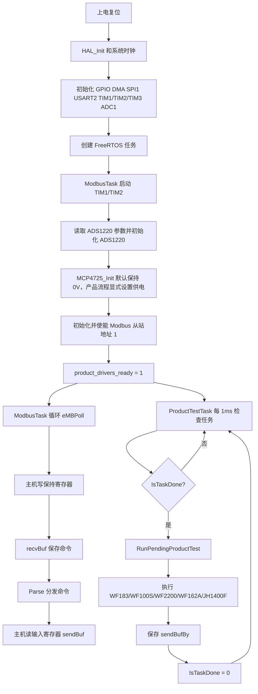
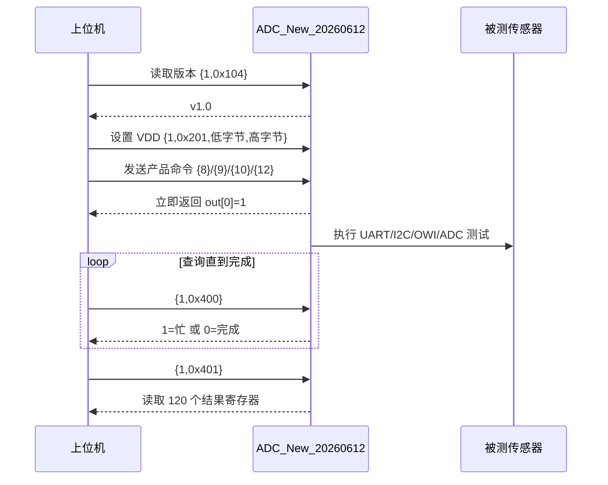

# ADC_New_20260612 测试流程

本文按照当前工程代码整理测试流程。主机通过 RS485/Modbus 写入保持寄存器提交命令，再从输入寄存器读取结果。

## 设备是如何确定的

当前固件**不会在上电后自动扫描并判断设备型号**。测试设备由上位机发送的 `cmd[0]` 选择，固件收到命令后进入对应测试函数：

上电后没有正在执行的测试，`IsTaskDone` 初始为 `0`，因此严格来说是“未选择设备/空闲”状态。代码中的 `IsTask_mub` 是零初始化，枚举值 `WF183DE` 也是 `0`，所以它的默认枚举值对应 WF183；但只有收到 `{8}` 并将 `IsTaskDone` 置为 `1` 后，才会真正执行 WF183 测试。不能把上电状态理解为已经自动识别出 WF183。

| 上位机命令 | 固件选择的测试 | 设备/接口特征 |
|---|---|---|
| `{8}` | `AllTestFor183()` | WF183，UART/I2C/OWI，I2C 地址 `0xDA`，VDD 3.3V |
| `{12}` | `AllTestFor100S()` | WF100S，ADS1220 通道测试，模拟供电 5V |
| `{10}` | `AllTestFor2200()` | WF2200，I2C 地址 `0xDA`，VDD 3.3V |
| `{11}` | `WF280CheckOtpReg()` | WF280，I2C 地址 `0x70`，OTP 对比，VDD 由主机预先设置 |
| `{9}` | `AllTestFor162A()` | WF162A，ADS1220 电流/双半桥/差分，依次供电 3.3V 和 5V |
| `{13}` | `AllTestForJH1400F()` | JH1400F，软件 I2C 地址 `0x70`，3.3V，桥值/温度/OTP |
| `{1, 0x567}` | `WF3050FtData()` | WF3050，参考传感器和被测传感器双路采集，VDD 3.3V |

因此，用户在上位机选择“WF280”时，上位机必须发送 `{11}`；如果发送的是 `{8}` 或通用 I2C 命令，固件不会自动把它改成 WF280 测试。

### 设备切换命令

切换方式是发送下一次测试命令；当前代码不会把型号写入 Flash，也没有单独的 `SET_DEVICE` 命令。常用命令如下：

```text
{8}              选择并排队 WF183 测试
{12}              选择并排队 WF100S 测试
{10}             选择并排队 WF2200 测试
{9}             选择并排队 WF162A 测试
{13}             选择并排队 JH1400F 测试
{11}             立即执行 WF280 OTP 测试
{1, 0x567}       立即执行 WF3050 采集
```

`{8}/{9}/{10}/{12}/{13}` 只是提交一次异步测试，测试结束后 `IsTaskDone` 会恢复为 `0`；下一次发送其他型号命令即可切换。执行期间发送新的型号命令会返回 `0xF1`（忙），应先查询 `{1, 0x400}` 直到返回 `0`。

WF183 的测试内部还有一次设备响应校验：发送 UART ID 命令 `55 04 24 37`，期望收到 `AA 08`。5 次都没有收到时，WF183 测试提前结束。这个动作只验证 WF183 UART 设备是否响应，不能替代上位机的型号选择。

```mermaid
flowchart TD
    A[设备接入并上电] --> B[固件启动]
    B --> C[空闲：IsTaskDone=0，未选择设备]
    C --> D[等待上位机 Modbus 命令]
    D --> E{上位机选择命令 cmd[0]}
    E -- 8 --> F[进入 WF183 测试]
    E -- 12 --> G[进入 WF100S 测试]
    E -- 10 --> H[进入 WF2200 测试]
    E -- 11 --> I[进入 WF280 OTP 测试]
    E -- 9 --> U[进入 WF162A 双供电测试]
    E -- 13 --> W[进入 JH1400F 测试]
    E -- 1,0x567 --> J[进入 WF3050 采集]
    F --> K[WF183 内部 UART ID 校验 AA 08]
    K --> L{响应成功?}
    L -- 否 --> M[结束 WF183 测试并返回已有结果]
    L -- 是 --> N[继续 WF183 UART/I2C/OWI 测试]
    G --> O[按 ADS1220 通道测试]
    H --> P[按 WF2200 I2C 寄存器/OTP 测试]
    I --> Q[按 0x70 地址读取两组 OTP 并比较]
    U --> V[按 ADS1220 采集 3.3V 和 5.0V 四组结果]
    W --> X[按 0x70 地址轮询并读取桥值、温度和两组 OTP]
    J --> R[参考传感器与被测传感器对比]
```

## 一、整体运行流程



上图中的关键点是：`cmd[0]` 只负责选择测试路径；固件没有一个“自动识别当前插入型号”的公共步骤。I2C 地址只用于访问设备，不用于在多个型号之间自动选择。

任务关系如下：

- `ModbusTask` 负责外部 Modbus 通讯、驱动初始化和命令解析。
- `ProductTestTask` 负责异步执行 WF183、WF100S、WF2200、WF162A、JH1400F。
- 产品测试期间，只有 `0x400` 状态查询和 `0x401` 结果查询允许进入；其他命令返回 `0xF1`（忙）。
- 产品测试完成后，主机必须重新读取 `0x400`，确认状态为 `0`，再读取 `0x401` 的 120 个结果寄存器。

## 二、主机命令总入口

```mermaid
flowchart TD
    A[Modbus 写入命令] --> B{cmd[0]}
    B -- 1 --> C[系统命令 ParseSystemCmd]
    B -- 2 --> D[软件 UART ParseSerialCmd]
    B -- 3 --> E[软件 I2C ParseI2CCmd]
    B -- 5 --> F[OWI ParseOwiCmd]
    B -- 8 --> G[排队 WF183]
    B -- 12 --> H[排队 WF100S]
    B -- 10 --> I[排队 WF2200]
    B -- 9 --> L[排队 WF162A]
    B -- 13 --> M[排队 JH1400F]
    B -- 11 --> J[同步 WF280 OTP]
    C --> K[sendBuf 返回结果]
    D --> K
    E --> K
    F --> K
    G --> L[IsTaskDone = 1]
    H --> L
    I --> L
    M --> L
    J --> K
```

### 系统命令 `cmd[0] = 1`

| 命令 | 功能 | 返回结果 |
|---|---|---|
| `{1, 0x104}` | 读取固件版本 | `{0x01, 0x00}`，即 v1.0 |
| `{1, 0x105}` | 读取 ADS1220 原始 ADC | 4 个寄存器，低字节在前 |
| `{1, 0x107, c0, c1, c2, c3}` | 设置 ADS1220 配置，不保存 | `out[0]` 为状态 |
| `{1, 0x108}` | 读取 ADS1220 配置 | 4 个配置寄存器 |
| `{1, 0x200, c0, c1, c2, c3}` | 设置并保存 ADS1220 配置 | `out[0]` 为状态 |
| `{1, 0x201, low, high}` | 设置 VDD，单位 mV | `3300` 为 3.3V，`5000` 为 5V，`0` 为关闭 |
| `{1, 0x202, enable}` | 控制 VPP | `cmd[2] != 0` 打开 |
| `{1, 0x400}` | 查询产品任务状态 | `1`=排队/执行中，`0`=空闲/完成 |
| `{1, 0x401}` | 读取产品测试结果 | 执行中返回 `0xF1` |
| `{1, 0x567}` | WF3050 参考/被测传感器采集 | 12 个结果寄存器 |
| `{1, 0x207, n}` | WF280 2.0 V/M1 电流和系数 | 状态、电流、系数 |
| `{1, 0x208, value, delay}` | WF280 3.3 V 温压输出 | 状态 + 6 字节 |
| `{1, 0x209, n}` | WF280 3.3 V 系数 | 状态 + n 个系数 |
| `{1, 0x210, value, delay}` | WF280 2.0 V 温压输出 | 状态 + 6 字节 |

## 三、五种产品的异步测试流程

### 1. WF183：`cmd[0] = 8`

```mermaid
flowchart TD
    A[主机发送 {8}] --> B[IsTask_mub = WF183DE]
    B --> C[IsTaskDone = 1，立即返回 out[0]=1]
    C --> D[ProductTestTask 执行 AllTestFor183]
    D --> E[设置 VDD = 3.3V]
    E --> F[等待 150ms]
    F --> G[ADS1220 读取短路/工作电流]
    G --> H{电流 >= 20mA?}
    H -- 是 --> I[记录短路/工作电流]
    H -- 否 --> J[UART 发送休眠命令]
    J --> K[UART 读取 ID，最多尝试 5 次]
    K --> L{ID 成功?}
    L -- 否 --> M[结束本次 WF183 测试]
    L -- 是 --> N[UART 读取版本和温压参数]
    N --> O[I2C 写温度命令并读取温度]
    O --> P[I2C 写压力命令并读取压力]
    P --> Q[OWI 读取压力]
    Q --> R[ADS1220 读取工作电流]
    I --> S[关闭 VDD]
    M --> S
    R --> S
    S --> T[测试完成，IsTaskDone = 0]
```

WF183 结果保存在 `sendBufBy` 的以下区域：

| 寄存器范围 | 内容 |
|---|---|
| `0..9` | UART ID |
| `10..19` | OWI 结果 |
| `20..29` | UART 版本 |
| `30..39` | UART 温度系数 TK |
| `40..49` | UART 温度系数 TB |
| `50..59` | UART 压力系数 PK |
| `60..69` | UART 压力系数 PB |
| `70..79` | UART 温度读取 |
| `80..89` | UART 压力读取 |
| `90..99` | I2C 温度读取 |
| `100..109` | I2C 压力读取 |
| `110..113` | 工作电流/短路检测结果 |
| `114..117` | 休眠电流 |

WF183 使用：

- VDD：3.3V。
- 产品 I2C：PB4/SDA、PB5/SCL。
- 产品 UART：PB6/TX、PB7/RX。
- I2C 地址：`0xDA`（8 位总线地址格式）。

### 2. WF100S：`cmd[0] = 12`

```mermaid
flowchart TD
    A[主机发送 {12}] --> B[排队并返回 out[0]=1]
    B --> C[ProductTestTask 执行 AllTestFor100S]
    C --> D[设置 VDD = 5.0V]
    D --> E[等待 150ms]
    E --> F[ADS1220 通道 0x01：工作电流]
    F --> G[ADS1220 通道 0xA1：AIN2 电压]
    G --> H[恢复通道 0x01]
    H --> I[ADS1220 通道 0xB1：AIN3 电压]
    I --> J[恢复通道 0x01]
    J --> K[ADS1220 通道 0x51：差分电压]
    K --> L[恢复测试前 ADS1220 配置]
    L --> M[关闭 VDD]
    M --> N[测试完成]
```

WF100S 结果长度为 16 个寄存器：`0..3` 工作电流，`4..7` AIN2，`8..11` AIN3，`12..15` 差分电压。WF100S 的模拟供电是 5V，其他产品测试供电为 3.3V。

### 3. WF162A：`cmd[0] = 9`

```mermaid
flowchart TD
    A[主机发送 {9}] --> B[排队并返回 out[0]=1]
    B --> C[ProductTestTask 执行 AllTestFor162A]
    C --> D[设置 VDD = 3.3V]
    D --> E[采集工作电流、Vout+、Vout-、差分]
    E --> F[设置 VDD = 5.0V]
    F --> G[采集工作电流、Vout+、Vout-、差分]
    G --> H[恢复 ADS1220 配置并关闭 VDD]
```

WF162A 结果长度为 32 个寄存器。`0..15` 是 3.3V 轮次，`16..31` 是 5.0V 轮次；每轮依次为工作电流、Vout+ 半桥电压、Vout- 半桥电压和 Vout+−Vout− 差分输出，每项占 4 个低字节在前的寄存器槽位。测试供电在两轮间切换，结束后关闭。

### 4. JH1400F：`cmd[0] = 13`

```mermaid
flowchart TD
    A[主机发送 {13}] --> B[排队并返回 out[0]=1]
    B --> C[ProductTestTask 执行 AllTestForJH1400F]
    C --> D[设置 VDD = 3.3V，等待稳定]
    D --> E[ADS1220 读取待机电流]
    E --> F[复位并读取产品 ID]
    F --> G[发送 0xAC，采集工作电流和桥温组合数据]
    G --> H[读取 0xAD 桥值和 0xAE 温度]
    H --> I[读取普通 OTP 与 M1 OTP]
    I --> J[恢复 ADS1220 配置并关闭 VDD]
```

JH1400F 默认 7 位地址为 `0x38`，软件 I2C 使用 8 位地址 `0x70`；SDO 高电平时将编译宏改为 `0x72`。每次读事务先保留 status 字节：产品 ID/OTP 为 status+2 字节，桥值/温度为 status+3 字节，桥温组合为 status+5 字节，最后一个数据字节发送 NACK。

JH1400F 结果长度为 98 个寄存器：`0` 为总体状态，`1..4` 和 `5..8` 为待机/工作电流，`9..11` 为产品 ID，`12..15` 为桥值，`16..19` 为温度，`20..25` 为桥温组合数据，`30..31` 为普通 OTP 状态，`32..63` 为普通 OTP，`64..65` 为 M1 OTP 状态，`66..97` 为 M1 OTP。NACK 或轮询超时会结束本次测试，但仍会释放总线、恢复 ADS1220 并关闭 VDD。

### 5. WF2200：`cmd[0] = 10`

```mermaid
flowchart TD
    A[主机发送 {10}] --> B[排队并返回 out[0]=1]
    B --> C[ProductTestTask 执行 AllTestFor2200]
    C --> D[设置 VDD = 3.3V]
    D --> E[等待并发送 WF2200 复位命令]
    E --> F[读取工作电流]
    F --> G[循环 3 个通道]
    G --> H[写寄存器起始地址并读取 4 字节 ID/寄存器]
    H --> I[写 OTP 起始地址并读取 14 字节 OTP]
    I --> J[写数据命令]
    J --> K[等待 5ms，启动采集]
    K --> L[读取 5 字节温压数据]
    L --> G
    G --> M[读取最终工作电流]
    M --> N[关闭 VDD]
    N --> O[测试完成]
```

WF2200 结果长度为 77 个寄存器：首段工作电流、3 组各 23 个寄存器的 ID/OTP/温压数据、末段工作电流。

## 四、WF280 测试流程

WF280 的直接驱动使用 I²C 地址 `0x70`，每个写字节都等待 ACK，读取最后一个字节发送 NACK，并按 `WF280_OS.c` 的 NOR 状态位轮询。系统命令会自动上电、检测短路/电流并在结束时关闭 VDD：

| 系统命令 | 供电/结果 |
|---|---|
| `{1, 0x207, n}` | M1/2.0 V，返回待机电流、工作电流和 `0x80` 系数区 `n` 项 |
| `{1, 0x208, value, delay}` | 3.3 V，发送 `0xAC` 后返回 6 字节温度/气压原始数据 |
| `{1, 0x209, n}` | 3.3 V，返回 `0x00` 系数区 `n` 项 |
| `{1, 0x210, value, delay}` | 2.0 V，发送 `0xAC` 后返回 6 字节温度/气压原始数据 |

### WF280 OTP 校验：`cmd[0] = 11`

WF280 使用独立的同步命令 `cmd[0] = 11`，不会进入 `ProductTestTask`，也不会自动设置或关闭 VDD。主机应先发送 `{1, 0x201, 0xE4, 0x0C}` 设置 3.3V，再发送 `{11}`。

```mermaid
flowchart TD
    A[主机设置 VDD = 3.3V] --> B[主机发送 {11}]
    B --> C[WF280CheckOtpReg]
    C --> D[寄存器 0x00..0x1F]
    D --> E[写地址 0x70 + 寄存器号]
    E --> F[读取 3 字节]
    F --> G[保存 OTP 第一组]
    G --> H[寄存器 0x80..0x9F]
    H --> I[写地址 0x70 + 寄存器号]
    I --> J[读取 3 字节]
    J --> K[与第一组逐项比较]
    K --> L{全部相等?}
    L -- 是 --> M[返回 {1, 0}]
    L -- 否 --> N[返回 {0xFF, 出错位置}]
    F --> O{I2C NACK/超时?}
    O -- 是 --> P[返回 {0xFF, 当前位置}]
```

WF280 结果只有两个寄存器：

- `{1, 0}`：两组 OTP 全部一致。
- `{0xFF, 1..32}`：第几个位置通信失败或两组 OTP 不一致。

因此，日志中如果显示 `IIC温压`、`CalT`、`P`，那是 WF183 的通用 I2C 流程，不是 WF280 OTP 测试的结果。WF280 应该看 `{1,0}` 或 `{0xFF,位置}`。

## 五、I2C、UART 和错误码

### I2C 命令格式

旧版 WF 测试软件格式仍然兼容：

```text
写：{3, channel, 0x11, address, reserved, length, payload...}
读：{3, channel, 0x22, address, reserved, length}
```

旧格式读操作的返回布局是：`out[0..length-1] = 数据`，`out[length] = 状态`。

新版通用格式是：

```text
{3, reserved, send_len, reserved, recv_len, reserved, address, payload...}
```

新版通用 I2C 返回布局是：`out[0] = 写状态`、`out[1] = 读状态`、`out[2..] = 数据`。产品内部 `ProductI2CTransfer()` 为保持产品结果布局，使用 `out[0..] = 数据`、`out[recv_len] = 状态`。

### 软件 UART

`cmd[0] = 2` 时，程序先初始化 PB6/PB7，发送命令并接收数据。如果第一次接收没有检测到有效波特率，会重新初始化 GPIO，重新发送并接收一次。有效响应不会重复发送。

### 常见错误码

| 错误码 | 含义 |
|---|---|
| `0xF1` | 产品测试正在执行，命令被拒绝 |
| `0xF2` | 命令长度、数据长度或输出缓冲区容量不匹配 |
| I2C 状态 `1` | NACK、SCL 超时或总线卡住 |
| WF280 `{0xFF, n}` | OTP 第 `n` 项通信失败或比较不一致 |

## 六、推荐的上位机操作顺序



WF280 OTP 的顺序不同：设置 VDD 后直接发送 `{11}`，等待同步返回两个结果寄存器；完整 OS 命令 `{1,0x207/0x208/0x209/0x210}` 自行上电、采集并断电。WF162A 使用 `{9}` 排队，完成后通过 `0x400/0x401` 读取 32 个结果寄存器；JH1400F 使用 `{13}` 排队，完成后读取前 98 个结果寄存器。

## 七、排查顺序

1. 先读取版本，确认烧录的是重新构建后的最新 HEX，而不是 `MDK-ARM/ADC/ADC.hex` 历史文件。
2. 确认产品命令没有混用：WF183 是 `{8}`，WF280 是 `{11}`，JH1400F 是 `{13}`；`IIC温压` 属于 WF183/通用 I2C 流程。
3. 确认 WF183/WF2200 使用地址 `0xDA`，WF280/JH1400F 默认使用地址 `0x70`；JH1400F 的 SDO 拉高时改为 `0x72`。
4. 检查 VDD：WF183/WF2200/WF280/JH1400F 为 3.3V，WF100S 模拟供电为 5V，WF162A 会依次使用 3.3V 和 5.0V。
5. 如果数据为 0，先看状态寄存器；读取失败时软件 I2C 会清零数据缓冲区，不能只看数据本身。
6. 如果出现 `0xF2`，先检查命令帧长度和返回缓冲区长度；它表示协议长度错误，不是传感器测量值。
7. 如果状态为 I2C 错误 `1`，再检查 PB4/PB5、3.3V 上拉、电源、地址和传感器是否真正连接。
